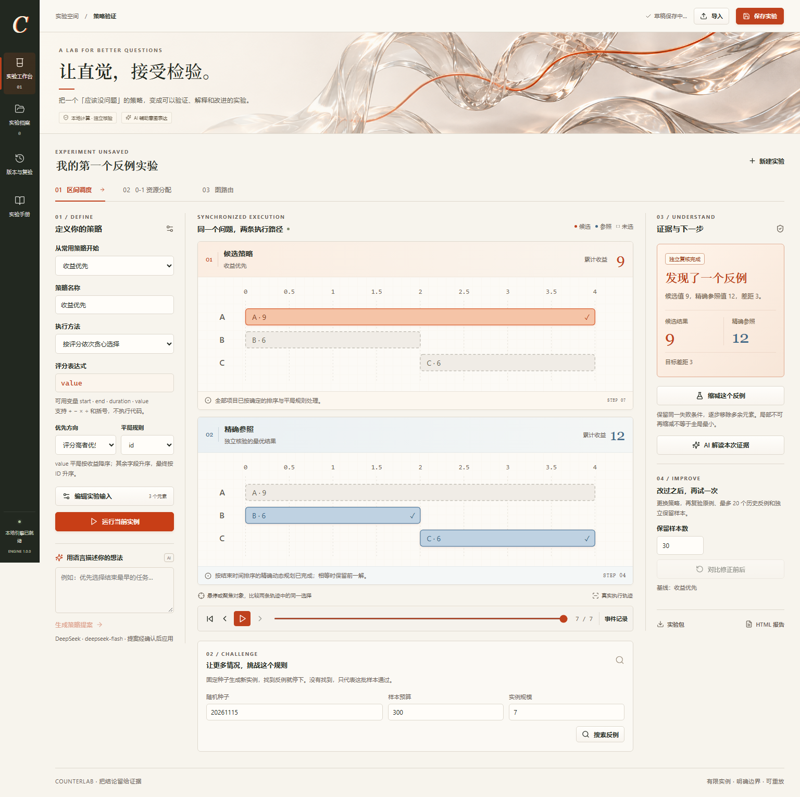

# 当前参赛作品：策镜 PolicyGlass

用户于 2026-11-16 选定 **PPO / SAC 神经网络底层机制的真实计算与交互讲解**。当前开发入口为 [PolicyGlass](policyglass/README.md)，完整方案见 [开发文档](policyglass/docs/DEVELOPMENT_PLAN.md)，实际进度见 [阶段交接](policyglass/handoffs/STAGE_1.md)。三个独立聊天按科学基础、3D教学产品、评估与交付串行推进。

下方光子芯片与 CounterLab 是历史项目，保留真实文件和 Git 演进，不代表当前作品范围。

# 历史项目：光铸 LightForge

当前开发入口与真实验收记录见 [LightForge](lightforge/README.md)。作品按用户选定的新方向重做，覆盖光子芯片逆向设计、电磁场、伴随梯度、约束优化与制造鲁棒性。旧项目及其真实 Git 历史保留归档，下面是原 CounterLab 的历史说明。

# CounterLab · 反例实验室（历史项目）

**让直觉，接受检验。**

CounterLab 是一个原创、本地优先的算法策略实验工作台：把想法写成明确规则，寻找使规则失效的输入，缩小反例，比较真实执行过程，再检查修改是否解决问题、是否引入退化。

它支持区间调度、0-1 资源分配和非负权图路由。计算与结论由确定性程序和独立参照核验完成；可选的 AI 负责提出策略与解释证据。没有密钥时，本地计算、搜索、缩减、回归、保存和实验包重放仍可运行。

## 当前进度与实际验证

三个领域的完整工作台、本地服务、实验存档和模型适配已实现，并完成计算、浏览器和独立目录运行检查。视频和 PDF 按当前要求暂不制作。

| 检查 | 已有结果 |
| --- | --- |
| 自动化计算与服务测试 | 92/92 通过：47 项引擎、28 项服务、7 项轨迹、10 项报告测试 |
| 独立 Python 参照 | 960/960 个有限样本通过，三个领域各 320 个 |
| DeepSeek 官方真实调用 | 服务端及真实工作台共4次；累计输入1943、输出948 token |
| 三领域示例包 | 实际搜索、缩减、回归，再完成导出→导入→重算 |
| 最终便携包独立运行 | Windows PowerShell 5 新目录解压、7278 个文件哈希、三领域 HTTP 全流程和 6 个实验重启恢复通过；解压至服务就绪 108.090 秒，完整验收 112.587 秒 |
| 完整浏览器流程 | 14/14 通过；桌面/390px手机、键盘、恢复、取消和故障路径 |

上述是当前记录，不是对所有输入的正确性证明，也不是模型响应速度承诺。详细依据见 [实测报告](docs/TEST_REPORT.md)、[引擎验证](evidence/engine-development.md)、[服务验证](evidence/server-development.md) 和 [真实开发证据规范](evidence/README.md)。



## 能做什么

- **检验具体规则。** 修改排序评分、方向、平局规则和领域输入，用精确参照检查当前策略。
- **寻找和缩减反例。** 用固定种子生成真实实例；每个接受的缩减步骤重新检查约束和同类失败。
- **对照执行证据。** 候选与参照都有真实计算轨迹，区分策略陷入死路和图本身不可达。
- **检查修改影响。** 比较原例、最多 20 个已保存历史反例和至多 100 个独立生成样本的前后结果。
- **保存与重放。** SQLite 保留输入和策略修订；JSON 实验包带版本及校验和，导入时重新计算；可导出独立 HTML 报告。
- **可选 AI 协助。** 自然语言生成受限策略提案，用户确认后使用；模型解释不能替代程序结论。

搜索未找到反例只表示这批样本没有找到。缩减得到的是指定操作下的局部结果，不能称为全局最小。完整范围见 [已知边界](docs/KNOWN_LIMITS.md)。

## Windows 便携版启动

便携包按下面方式运行：

1. 将完整 ZIP 解压到 D 盘普通目录，例如 `D:\CounterLab`。
2. 双击 `Start-CounterLab.cmd`，保持命令窗口打开。
3. 等待服务打印监听成功信息，打开显示的本机地址，默认 `http://127.0.0.1:4317`。

包内提供 Node.js 24.22.1、生产依赖和 [三个可导入的真实示例](examples/README.md)。不需要另租服务器、安装数据库、购买 GPU 或配置模型密钥。按 `Ctrl+C` 停止服务。启动脚本拒绝 C 盘应用/数据路径，不会自动打开默认浏览器。

使用步骤见 [用户指南](docs/USER_GUIDE.md)，版本、缓存路径、发行校验与故障排查见 [启动和复现](docs/REPRODUCIBILITY.md)。

源码另提供 `Start-CounterLab-Background.cmd` / `Stop-CounterLab-Background.cmd`，将服务作为独立后台进程启动或停止；后台启动器退出后服务继续运行。该入口使用当前源码环境或指定的便携运行时，日志与进程记录在 D 盘数据目录。重启电脑后需再次启动。现有 ZIP 的前台入口仍需保持窗口打开；本机工作区的 `启动反例实验室.cmd` 已改用独立后台启动。

## 从源码运行

把仓库克隆到 D 盘，例如 `D:\CounterLab-source`。使用 Windows x64、Node.js **24.22.1**、pnpm **11.25.0**，然后在 PowerShell 执行：

```powershell
Set-Location -LiteralPath 'D:\CounterLab-source'
. .\scripts\env.ps1
pnpm install --frozen-lockfile
pnpm build
.\scripts\start.ps1
```

首次安装依赖需要网络；`env.ps1` 将工具缓存、临时文件及浏览器下载定向到 D 盘。源码开发可分别运行 `pnpm dev` 和 `pnpm dev:ui`，两个终端都先加载 `env.ps1`；Vite 默认在 `http://127.0.0.1:5173` 代理本地服务。

运行验证：

```powershell
. .\scripts\env.ps1
pnpm check
pnpm test
# 可选：独立参照验证，需要可用的 Python 3。
python -B tests/oracle.py
```

浏览器验证及发行包命令见 [复现文档](docs/REPRODUCIBILITY.md)。Python 和浏览器测试依赖不属于便携版运行要求。

## 可选：接入 DeepSeek 官方 API

在 D 盘应用目录将 `.env.example` 复制为 `.env`，只在本机填写自己的密钥：

```dotenv
COUNTERLAB_AI_BASE_URL=https://api.deepseek.com/v1
COUNTERLAB_AI_MODEL=deepseek-flash
COUNTERLAB_AI_PROVIDER=DeepSeek
COUNTERLAB_AI_KEY=
```

保留空密钥即可使用离线计算；需要 AI 时再填写并重启服务。不要将真实密钥发到仓库、截图、报告或实验包。模型调用按自己的官方账户计费，批量算法搜索不逐例调用模型。没有配置或服务不可用时会明确提示，不用模拟回答冒充在线结果。

## 文档与提交边界

- [用户指南](docs/USER_GUIDE.md)：规则、三个领域、结果解释、回归与重放。
- [架构说明](docs/ARCHITECTURE.md)：模型与确定性执行的边界、存储和任务流程。
- [已知限制](docs/KNOWN_LIMITS.md)：输入规模、结论范围、资源和证据边界。
- [启动和复现](docs/REPRODUCIBILITY.md)：D 盘配置、源代码构建、便携包及校验。
- [第三方来源与许可](docs/THIRD_PARTY.md)：通用方法、基础库、运行时与生成素材。
- [开发方案](docs/DEVELOPMENT_PLAN.md)、[验收门槛](docs/ACCEPTANCE.md)、[真实开发证据](evidence/README.md)：源码仓库中的设计和过程材料。

当前不宣称比赛材料已全部完成。演示视频和 PDF 按用户要求暂未制作；本人 AI 协同展示与完整开发证据仍需最终核验。未进行大规模真人教学实验，不报告虚构的学习收益或承诺评审分数。

