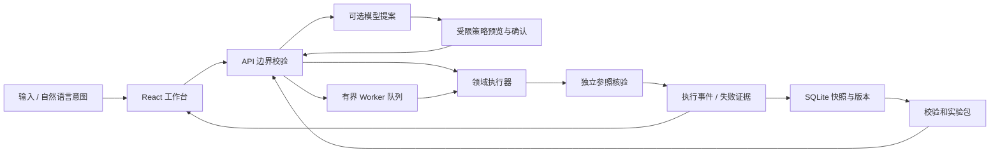

# 架构与意图控制

CounterLab 把「提出一种规则」和「判断规则是否失效」分开：人和模型可以提出候选策略，结论由固定语义的执行器计算。所有实验均在本机运行，只有主动点击 AI 功能时才访问所配置的模型接口。

## 数据流与模块边界

- `src/shared/types.ts` 定义输入、策略、执行事件、结论和实验包类型；浏览器与服务端共享契约。
- `src/engine` 只依赖领域数据和标准语言能力，不依赖 React、HTTP、SQLite 或模型供应商。评分表达式用有界解析器和精确有理数执行，不使用 `eval`。
- `server/validation.ts` 将不可信 JSON 转换为受限输入。保存、导入及 AI 解释会重算实例；不信任客户端送来的最优值、结论或轨迹。
- `server/jobs.ts` 单 Worker、最多 8 个在途任务，45 秒计算上限，运行态可取消。共享标志支持自然停止，进程终止处理硬超时；Worker 不是任意代码沙箱。
- `server/store.ts` 使用 SQLite WAL 保存实验、版本和任务状态。重启将未完成任务标为中断，不虚报完成。策略或输入改变时保留上一版本的实例和计算证据。
- `src/app` 编辑当前草稿并渲染真实执行事件。长计算通过任务轮询得到进度；图表不另造一套判定逻辑。

## 三层正确性检查

产品参考解分别使用区间动态规划、0-1 背包动态规划、Dijkstra。反例核验另外使用独立子集枚举、另一实现的精确背包求解、Bellman–Ford，并检查返回解的可行性。开发期还有 Python 子集/简单路径枚举，它不调用产品求解器。

这些检查减少共享实现错误；它们仍然不是对全部程序及无限输入空间的形式化证明。随机搜索有固定种子和明示预算，`not_found` 仅表示这批样本没有找到反例。当前版本没有提供有限空间穷尽模式，所以不会显示 `bounded_pass`。

图中「策略未到达终点」和「全图不可达」分别处理。JSON 用有限数值表示结构，`complete` 与 `reason` 决定语义，界面不能把占位数值 0 解释为零代价最优路径。

## 模型约束

模型只返回 `strategy / explanation / assumptions` 或一段解释 JSON。允许的算法、字段、表达式变量、大小和深度都固定。提案不会自动应用；用户确认后才修改草稿，之后仍需运行实验。未知字段、代码片段、跨领域策略、非法算术会被拒绝。

模型解释只获得该次计算证据。它可能出现文字错误，程序数值才是判定来源。官方 DeepSeek 请求显式关闭思考模式并限制输出、超时、响应体和会话调用数；其他兼容服务不附加供应商专有字段。密钥不进入浏览器、Git、报告或导出包。

## 持久化与重放边界

导出包含输入、规则、版本、实际执行、种子、执行器版本和 SHA-256 校验和。校验和检测无意改变，不证明文件来自某位作者。导入还会进行结构检查、版本匹配、实例重算及缩减链检查；不把保存的采样计数当作重新跑过的覆盖率。导入后只声明缩减证据仍成立，不沿用未经重跑的局部最小性结论。

产品实验重放、从锁文件重建程序、重新让随机模型生成同一源码是三件不同的事。前两项由固定输入/版本和源码/依赖支持；不能保证第三项逐字一致。真实开发过程记录与产品实验包分别保存。
